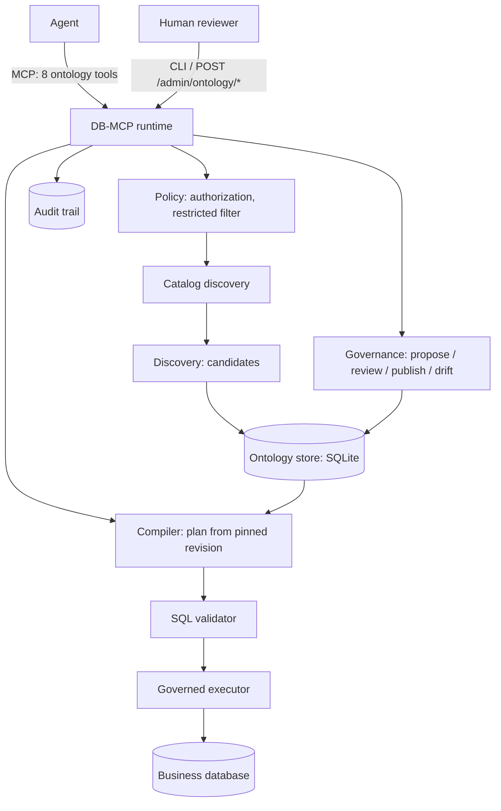

# DB-MCP governed ontology: architecture

The ontology is a versioned, certified semantic control plane over the existing DB-MCP catalog,
policy engine and governed executor. It is not a second SQL agent: every statement it runs is
assembled from typed, human-certified definitions, re-validated by the SQL analyzer, and executed
by the same `BoundedExecutor` that serves `execute_query`.

Status: implemented in v0.2.0 (`crates/db-mcp-ontology`, wired in `crates/db-mcp-mcp` and
`crates/db-mcp-server`). The design borrows the certification idea of NVIDIA Auto Ontology; it is
a native Rust implementation and is not API-compatible with that product.

## Components

| Module | Responsibility |
|---|---|
| `model.rs` | Definitions (entity, attribute, relationship, metric, filter), lifecycle, certifications, revisions, question evidence, content hashing, HMAC |
| `store.rs` | Dedicated SQLite metadata store, scoped by `(tenant_id, connection)`; immutable versions; compare-and-set status transitions; atomic publish |
| `discovery.rs` | Deterministic candidate extraction from the policy-filtered catalog (tables, columns, declared FKs, `<x>_id` inferred joins, numeric measures, routine read/write evidence) |
| `governance.rs` | Proposals with typed validation, review (separation of duties), publish, certification verification, schema-drift invalidation |
| `retrieval.rs` | Lexical ranking (tokenizer, light stemming, field weights, IDF, phrase bonus); no embeddings, no network |
| `compiler.rs` | Question to plan: metric, filters, dimensions, shortest certified join path, fan-out refusal, engine-aware SQL, validator, plan hash |
| `eval.rs` | Golden-question evaluation with hard refusal gates |



## Lifecycle

```text
discovered --> proposed --> in_review --> certified --> published --> stale / deprecated
     \             \             \             \
      `-------------`-------------`-------------`--> rejected
```

- Content of a version never changes. Revising a definition inserts version `n+1` and requires
  `expected_version = n` (optimistic concurrency).
- Only `published` versions that belong to the latest revision and pass certification
  verification can generate SQL.
- Discovery never overwrites certified or published content. A changed candidate is stored as a
  new `discovered` version for review.

## Planning pipeline

1. Authorize the caller on the connection; discover the catalog with restricted objects removed.
2. Compute the live schema fingerprint and run the drift check (`stale` marking).
3. Load the latest revision and its published definitions; drop definitions on restricted tables.
4. Split the question into a metric phrase and dimension phrases (`by`, `per`, `for each`, ...).
5. Rank metrics. Refuse when nothing matches, when only generic words match ("number", "total"),
   when two certified metrics both match exactly (ambiguity), or when the best match is stale.
6. Attach certified filters whose distinctive words appear in the question, plus the metric's
   default filters.
7. Resolve dimensions to certified, non-sensitive attributes; prefer the one reachable with the
   fewest joins among near-ties.
8. Find the shortest path over published relationships only. Refuse any hop that is one-to-many
   relative to the metric grain (double counting).
9. Emit SQL with aliases, minimal engine quoting, bound parameters (`?N`, `$N`, `?`), `GROUP BY`,
   `ORDER BY`, `LIMIT`.
10. Validate: one statement, `SELECT`, read-only, no privileged functions, no analyzer warnings,
    referenced tables exactly within the plan's allowlist.
11. Re-verify each used definition's certification; compute `plan_hash` over SQL, params,
    revision and schema fingerprint; record question evidence.
12. `ask_semantic_question` executes through the governed executor with the caller's identity, so
    connection policy, limits, redaction and auditing apply unchanged.

## Storage

`[ontology] storage_path` points at a dedicated SQLite file. Tables: `ontology_definitions`,
`ontology_certifications`, `ontology_revisions`, `ontology_question_evidence`. The server and the
admin CLI may open the file concurrently (SQLite locking, 5 s busy timeout). Without a
`storage_path` the store is in memory (demo only) and the CLI refuses to review.

## Limits and known gaps

- Planning is deterministic and lexical. Phrasing far from certified names and synonyms returns
  `not_answerable`; add synonyms through a proposal instead of relying on fuzzy matching.
- One metric per question. Ratios, period comparisons and time-bucketing are not compiled yet.
- Relationship cardinality for agent proposals is trusted as certified by the reviewer; declared
  FKs are always many-to-one from the referencing table.
- PostgreSQL/MySQL connections run on the embedded simulation in this release; plans are
  validated against their dialect but results are illustrative and flagged as such.
